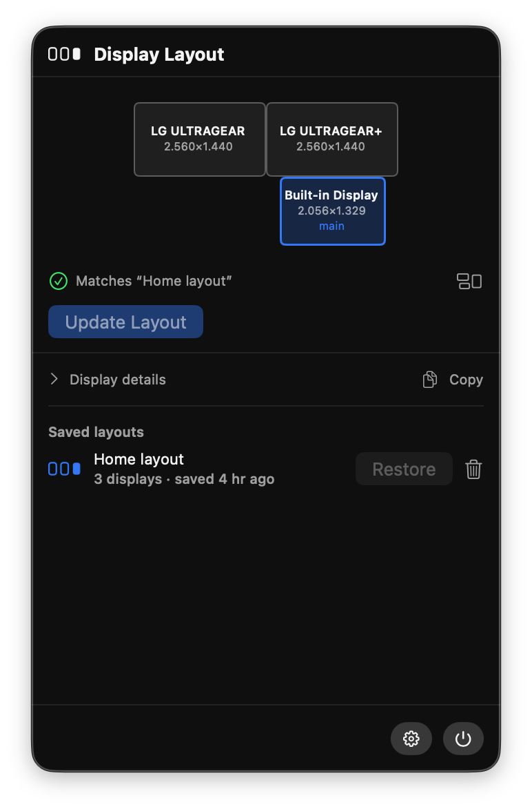
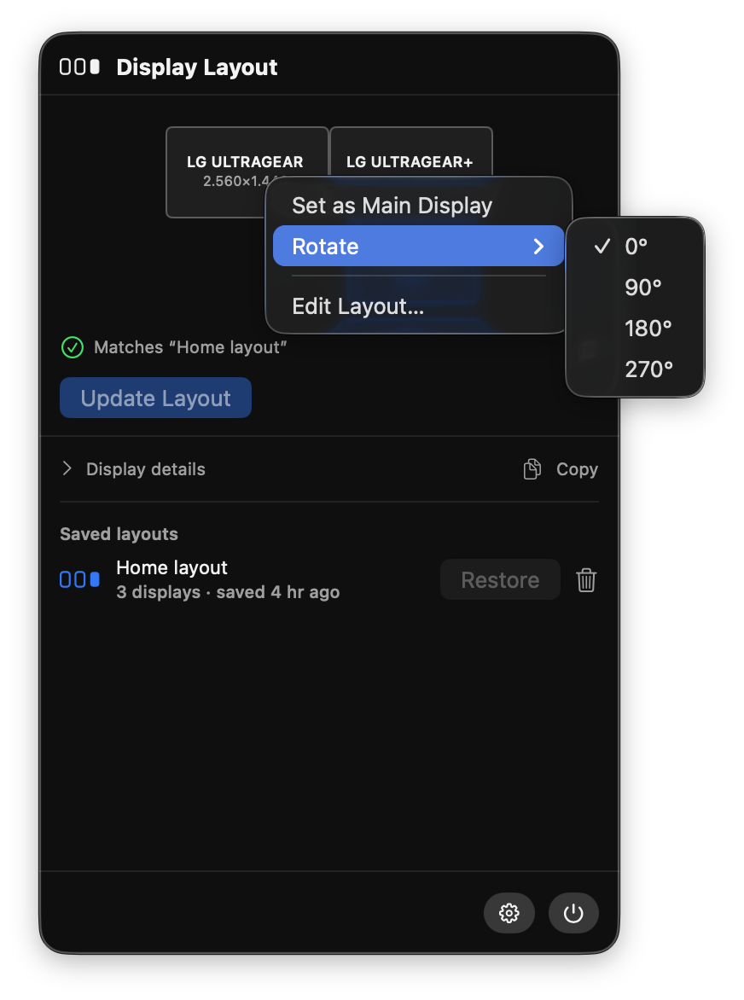
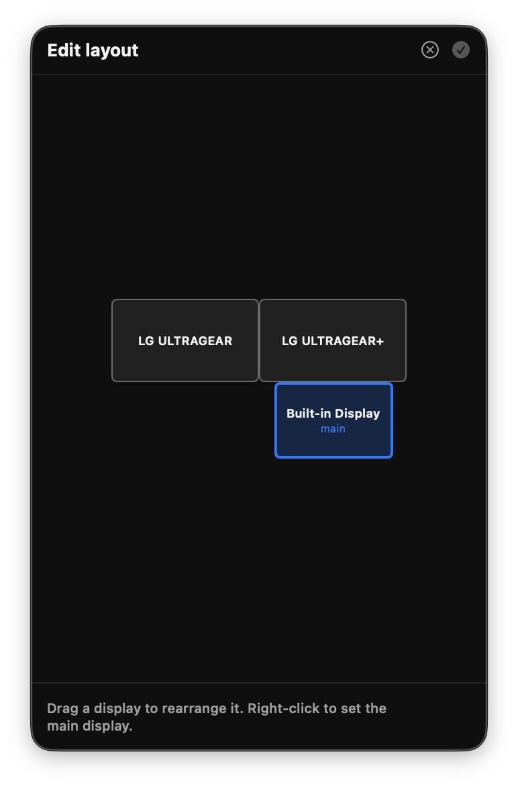
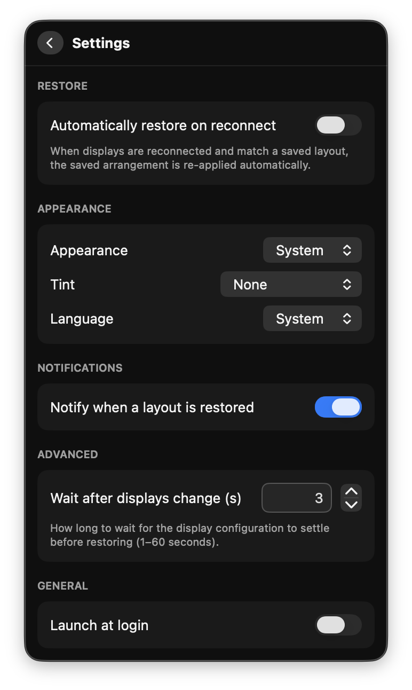

# DisplayAnchor

A tiny macOS menu bar utility that **remembers and restores your display arrangement**
when you disconnect/reconnect external monitors (typically through a Thunderbolt/USB-C
dock). It works around the well-known macOS bug where the relative positions of your
monitors, the main-display designation, and per-display resolution get scrambled on
replug.

It does only this one thing. No window-position management, no accounts, no network,
no external dependencies — and it needs **no special permissions** (no Accessibility,
no Screen Recording).

<p align="center">
  
</p>

> [!IMPORTANT]
> **Requires macOS 26 or later**, and the app is **not signed with an Apple Developer ID**
> — the first launch takes two extra clicks. Both points are explained below
> ([Requirements](#requirements), [Opening an unsigned app](#opening-an-unsigned-app)).

## How it works

- **Save** a layout manually (button in the popover) when your displays are arranged
  the way you like. The arrangement is captured per _set of connected displays_ and
  stored locally.
- **Restore** happens automatically: when you reconnect and the connected set matches a
  saved layout, the saved arrangement is re-applied (after the configuration settles).
  You can also restore on demand.
- Because saving is always manual, the broken layout macOS produces right after a
  reconnect can never overwrite your good saved layout.

Under the hood it uses public CoreGraphics / Quartz Display Services APIs
(`CGGetActiveDisplayList`, `CGDisplayBounds`, `CGConfigureDisplay*`,
`CGCompleteDisplayConfiguration`) and identifies displays by their ColorSync UUID
(`CGDisplayCreateUUIDFromDisplayID`) with a vendor/model/serial fallback. Connect and
disconnect events are detected with `CGDisplayRegisterReconfigurationCallback`,
debounced until the configuration settles. Rotation is the one thing CoreGraphics
exposes read-only: it is written through the IOKit framebuffer transform
(`IOServiceRequestProbe` with `kIOFBSetTransform`, the fb-rotate technique) and,
because the transform resets the display mode, the previous mode is re-applied once
the rotation settles.

## Requirements

- macOS 26 or later
- Xcode 26 (Swift 6.2) to build from source

The macOS 26 floor comes from the UI layer (Liquid Glass panel chrome), not from the
display logic, which uses long-standing CoreGraphics APIs. Lowering the deployment
target hasn't been necessary so far, but support for earlier macOS versions may land
in a future release. If you'd find it useful, open an issue — it helps gauge demand.

## Opening an unsigned app

DisplayAnchor is **ad-hoc signed**, not signed with a paid Apple Developer ID, and it
is not notarized. There's no developer account behind this project. Practically:

- **Building from source** (below) is the smoothest path — locally built apps carry no
  quarantine flag and just open.
- **Downloading a release** puts macOS Gatekeeper in the way: the first launch is
  blocked with a "cannot be opened because Apple cannot check it for malicious
  software" message. To allow it, open **System Settings → Privacy & Security**,
  scroll to the security section, and click **Open Anyway** next to DisplayAnchor,
  then confirm. You only do this once.

  Equivalently, from the Terminal:

  ```bash
  xattr -d com.apple.quarantine /Applications/DisplayAnchor.app
  ```

This is the standard situation for any unsigned open-source macOS app. The source is
right here — read it, or build it yourself, if you'd rather not take the binary on
trust.

## Build & install

```bash
git clone https://github.com/gabriarceus/DisplayAnchor.git
cd DisplayAnchor
./build.sh
```

`build.sh` asks whether to install to `/Applications` (replacing any existing
copy); answer `n` to keep the app in `build/` and run it from there with
`open "build/DisplayAnchor.app"`. In non-interactive runs (CI, piped)
the question is skipped.

The app is ad-hoc signed and runs as a menu-bar-only accessory app (no Dock icon).
Notifications and launch-at-login only work from the built `.app` bundle, not under
`swift run`.

The UI foundation (panel, chrome, design tokens, reusable components) lives in the
[`MenuBarKit`](https://github.com/gabriarceus/MenuBarKit) package, shared with the
other menu bar apps; the panel chrome uses Liquid Glass. It is resolved from GitHub by
default — if a `MenuBarKit` checkout sits next to this repo, that local copy is used
instead so you can edit both at once. SwiftPM caches the evaluated manifest keyed by
its contents, which don't change when the sibling appears or disappears — so after
adding or removing it, run `swift package purge-cache && swift package reset` once
(`reset` alone clears `.build` but not the shared manifest cache).

> The app must remain **non-sandboxed** — writing display configuration is blocked under
> the App Sandbox, so this cannot ship via the Mac App Store.

## Using it

|                                                                             Quick actions                                                                              |                                                                             Layout editor                                                                              |                                                                             Settings                                                                              |
| :--------------------------------------------------------------------------------------------------------------------------------------------------------------------: | :--------------------------------------------------------------------------------------------------------------------------------------------------------------------: | :---------------------------------------------------------------------------------------------------------------------------------------------------------------: |
|  |  |  |

The menu bar icon, the popover title, and each saved-layout row show a row of small
rectangles that mirrors the number of connected displays (up to four). The menu bar
icon still switches to a checkmark right after a restore and to an exclamation mark when
the current arrangement has drifted from the saved one.

Click the menu bar icon to open the popover:

- A **mini-map** of the current arrangement (main display highlighted; rotated
  displays are drawn with their real portrait/landscape footprint and labelled with
  the rotation angle). **Right-click a display** for quick actions:
  - **Set as Main Display** — applied immediately, preserving the relative arrangement.
  - **Rotate** — 0° / 90° / 180° / 270°, applied immediately; the display keeps the
    resolution it had before rotating.
  - **Edit Layout…** — opens the drag-and-drop layout editor (two or more displays).
- The **layout editor**: drag the displays around a canvas to rearrange them — they
  snap flush to their neighbours' edges and cannot overlap. Right-click a display to
  make it the main one. Everything happens on an in-memory draft: ✓ applies the drawn
  arrangement to the real displays, ✗ discards it. Restoring a saved layout also
  restores each display's saved rotation.
- **Display details** (expandable): per-monitor model / serial / vendor / unit / UUID,
  plus a **⚠︎ indistinguishable** badge when two monitors share the same EDID (identical
  model, equal/zero serial). A **Copy** button copies the full diagnostics to the
  clipboard and briefly confirms with a "Copied to clipboard" badge.
- **Save Layout** for a new display set, or **Update Layout** — enabled only when the
  current arrangement has drifted from the saved one.
- A **pause** control (shown only while auto-restore is enabled) that suspends
  automatic restore for 15 minutes so you can rearrange displays freely. Auto-restore
  also pauses itself — with a notification — whenever you change the layout manually
  (set main, rotate, apply an edited layout), so it won't immediately undo your edit.
- The list of **saved layouts**: **double-click a name to rename**, delete (with an
  inline two-step confirm so a stray click can't wipe a layout), and **Restore** the
  current set from its row.
- A footer with **Settings** and **Quit**.

## Settings

| Setting                              | Default | Description                                                                                                                                      |
| ------------------------------------ | ------- | ------------------------------------------------------------------------------------------------------------------------------------------------ |
| Automatically restore on reconnect   | off     | Re-apply a matching saved layout when displays settle after a change (skipped when the arrangement already matches).                             |
| Appearance                           | System  | Panel appearance: System, Dark, or Light                                                                                                         |
| Tint                                 | None    | Glass tint mode: None, Match macOS (system accent), or Custom with a swatch row (Blue, Purple, Pink, Red, Orange, Yellow, Green, Graphite, Teal) |
| Notify when a layout is restored     | on      | Post a notification after an automatic restore.                                                                                                  |
| Wait N seconds after displays change | 3       | How long to wait for the configuration to settle before restoring.                                                                               |
| Launch at login                      | —       | Registers the app via `SMAppService` (built `.app` bundle only).                                                                                 |
| Check for updates automatically      | on      | Once a day, look for a newer GitHub release. See [Updates](#updates).                                                                            |

Saved layouts are stored at
`~/Library/Application Support/DisplayAnchor/profiles.json`
(a versioned JSON document keyed by display-set fingerprint). Settings live in
UserDefaults under `io.github.gabriarceus.DisplayAnchor`.

## Updates

DisplayAnchor checks whether a newer version has been released — it does not download
or install anything. With no Developer ID signature, a real in-app installer would have
to strip quarantine and swap the running bundle itself; a link to the release page is
the honest version of that.

- **Where it shows up**: Settings → Updates lists the running version, the automatic
  check toggle, and a **Check Now** button. When an update exists, the settings gear in
  the main panel gets an orange dot and a **Download** button appears in Settings.
- **How it works**: an unauthenticated `GET` to
  `api.github.com/repos/gabriarceus/DisplayAnchor/releases/latest`, whose `tag_name`
  is compared against `CFBundleShortVersionString`. The background check runs at most
  once every 24 hours (at launch and when the panel is opened); network failures and
  rate limiting are silent — only a manual check reports them.
- **Turning it off**: the automatic-check toggle. Nothing is sent to GitHub beyond the
  request itself: no identifier, no telemetry, no account.
- Downloaded updates are quarantined by macOS like the first install — see
  [Opening an unsigned app](#opening-an-unsigned-app).

### Cutting a release

```bash
# 1. bump CFBundleShortVersionString (and CFBundleVersion) in Info.plist, commit
./release.sh
```

`release.sh` refuses to run on a dirty tree or an existing tag, builds the app, zips it
with `ditto`, pushes, and creates the GitHub Release tagged `v<version>` — which is what
existing installs then see.

## Localization

The app ships in **English** and **Italian**, and picks the language from the **Language** setting (Appearance section) — _System_ follows macOS, or force a specific one. All UI strings and notifications are localized.

Adding a language needs **no code**:

1. Duplicate the folder `Sources/DisplayAnchor/Resources/en.lproj` and rename the copy with your language code, e.g. `fr.lproj` (`de.lproj`, `es.lproj`, …).
2. In the copied `Localizable.strings`, translate only the **right-hand** side of each line — keep the keys (left of `=`) unchanged:
   ```
   "common_settings" = "Réglages";
   ```
3. Keep the format specifiers (`%@`, `%d`, `%%`) intact; you may reorder them if the sentence needs it.
4. Rebuild — the new language appears automatically in the Language picker (listed in its own name).

The picker is populated from the bundled `.lproj` folders, so it grows on its own. Missing keys fall back to English. The `SectionLabel` fields render uppercase automatically, so write them in normal case.

## Known limitations

1. **Same-model monitors** are distinguished by their ColorSync UUID, which is derived
   from the full EDID and usually differs between two units of the same model even when
   the numeric serial is `0`. Only monitors whose EDID is _byte-identical_ are truly
   indistinguishable; in that case the app falls back to a port-order heuristic and the
   display-details list flags them with a ⚠︎ badge. Truly-identical displays are a
   fundamental macOS limitation, not an app bug.
2. **Rotation** is written through an IOKit framebuffer probe rather than a public
   CoreGraphics call. It works on standard configurations, but the display-to-service
   matching is EDID-based: two _byte-identical_ monitors resolve to the first match,
   so rotating one of two truly indistinguishable displays may rotate the other.
3. **Not sandboxable** (see above), so no Mac App Store distribution.
4. **GPU switching** (e.g. eGPU connect/disconnect) can invalidate display UUIDs more
   aggressively; you may need to re-save the layout afterwards.
5. If a monitor reports a different set of modes after reconnect, the closest matching
   resolution is applied.

## Architecture

| File                                                      | Responsibility                                                                                                                                                                                                                  |
| --------------------------------------------------------- | ------------------------------------------------------------------------------------------------------------------------------------------------------------------------------------------------------------------------------- |
| `main.swift`                                              | AppKit bootstrap (accessory activation policy)                                                                                                                                                                                  |
| `AppDelegate.swift`                                       | Status item, panel, dynamic display-count icon                                                                                                                                                                                  |
| `AppConfig.swift`                                         | UserDefaults-backed settings model                                                                                                                                                                                              |
| `LayoutModels.swift`                                      | `Codable` types: identity, mode, snapshot, profile                                                                                                                                                                              |
| `DisplayEngine.swift`                                     | CoreGraphics/ColorSync/IOKit: snapshot, apply, rotation, fingerprint, diagnostics                                                                                                                                               |
| `DisplayMonitor.swift`                                    | Reconfiguration callback, debounce, restore-loop guard                                                                                                                                                                          |
| `LayoutEditing.swift`                                     | Pure editor helpers: draft model, snapping, overlap resolution                                                                                                                                                                  |
| `ProfileStore.swift`                                      | JSON persistence of saved profiles                                                                                                                                                                                              |
| `LayoutStore.swift`                                       | Save/restore policy, live edits (main/rotate/rearrange), published state                                                                                                                                                        |
| `Views/PanelRootView.swift`                               | Panel navigation between main view, settings, and editor; glass chrome + tint                                                                                                                                                   |
| `Views/PopoverView.swift`                                 | Root popover                                                                                                                                                                                                                    |
| `Views/DisplayMapView.swift`                              | Proportional mini-map with right-click quick actions                                                                                                                                                                            |
| `Views/DisplayMapGeometry.swift`                          | Display-space ↔ view-space transform shared by map and editor                                                                                                                                                                   |
| `Views/LayoutEditorView.swift`                            | Drag-and-drop layout editor (draft, apply/cancel)                                                                                                                                                                               |
| `Views/DisplayDetailView.swift`                           | Per-display diagnostics + indistinguishable badge                                                                                                                                                                               |
| `Views/ProfileRowView.swift`                              | One saved-layout row                                                                                                                                                                                                            |
| `Views/SettingsView.swift`                                | Settings form + launch-at-login                                                                                                                                                                                                 |
| `Views/DisplayCountIcon.swift`                            | Template icon of N rectangles for the display count                                                                                                                                                                             |
| `Views/HoverTip.swift`                                    | Fast-appearing hover tooltip modifier                                                                                                                                                                                           |
| `Resources/*.lproj`                                       | Per-language `Localizable.strings` tables (see [Localization](#localization))                                                                                                                                                   |
| [`MenuBarKit`](https://github.com/gabriarceus/MenuBarKit) | Shared package: `MenuBarPanel`, Liquid Glass `PanelChrome` (optional tint), `PanelNavigation`, `Notifier`, `Localizer` + `Bundle.languageOptions`, `Theme` tokens, `PanelHeader`/`SectionLabel`/`GlassIconButton`/`inputChrome` |

## License

[MIT](LICENSE) © 2026 Gabriarceus
