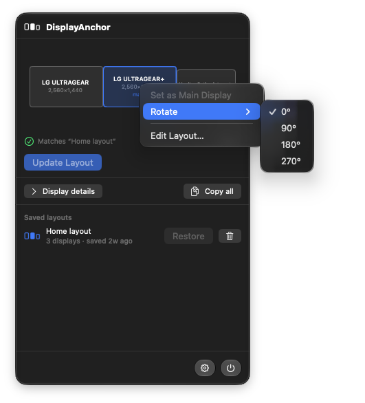
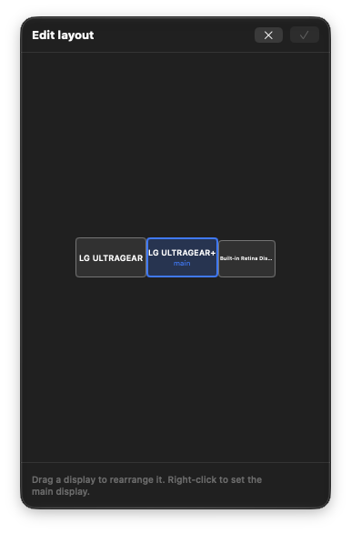
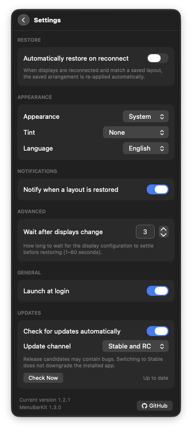

# User guide

DisplayAnchor saves your preferred arrangement for each set of connected displays. Saving is manual, so the layout macOS produces after reconnect cannot overwrite your saved arrangement. Restoring can be manual or automatic.

## Requirements and installation

The app requires macOS 26 or later. Pre-built releases are Universal Binaries for Apple Silicon and Intel Macs.

Download the versioned zip from the [latest release](https://github.com/gabriarceus/DisplayAnchor/releases/latest), unzip it, and drag DisplayAnchor.app into Applications. Open it and click its menu bar icon to access the panel. The app has no Dock icon or separate main window.

You can also [build from source](development.md#building-and-running) on a compatible Mac.

## Opening a downloaded app

DisplayAnchor is ad-hoc signed, without an Apple Developer ID or notarization. macOS can block the first launch of a downloaded copy. Open System Settings → Privacy & Security, find DisplayAnchor in the security section, choose Open Anyway, and confirm. This approval is needed once for the downloaded app. Locally built copies normally open without download quarantine, and in-app updates avoid repeating the approval.

Display management needs neither Accessibility nor Screen Recording permission.

## Save and restore

1. Arrange your displays as you prefer, then choose Save Layout in the panel.
2. Enable Automatically restore on reconnect in Settings if you want automatic restore. It is off by default.
3. When that display set reconnects, or when the app starts, the app waits for the configuration to settle and restores the matching saved layout if it differs. You can also restore manually.

Save Layout creates a profile for a new display set. Update Layout replaces the matching saved arrangement and is available when the current layout differs. Manual edits do not update the saved profile until you choose to save.

## Panel and layout editing

|                                                       Quick actions                                                       |                                            Layout editor                                             |                                     Settings                                     |
| :-----------------------------------------------------------------------------------------------------------------------: | :--------------------------------------------------------------------------------------------------: | :------------------------------------------------------------------------------: |
|  |  |  |

- The mini-map shows the current arrangement, highlights the main display, and shows rotated displays with their portrait or landscape footprint and rotation angle.
- Right-click a display to make it the main display, rotate it, or open Edit Layout. Main-display changes preserve relative positions. Rotation supports quarter turns. macOS resets the arrangement after a rotation, so the app waits for the displays to settle and then restores the resolutions and positions. This can take several seconds.
- The editor is available with two or more displays. Drag displays to rearrange them inside the editor area, which centers on the arrangement after each move at the same zoom; they snap to neighboring edges and cannot overlap. A display dropped away from the others moves next to the nearest one, or back to where the drag started when no position keeps every display connected. Right-click to select the main display. Apply changes the real arrangement; Cancel discards the draft.
- The pause control suspends automatic restore for 15 minutes. Successful main-display, rotation, or editor changes also pause it and notify you, so restore does not undo your edit immediately. The control appears when automatic restore is enabled.
- Saved-layout rows let you restore the current set, double-click a name to rename it, or delete with a two-step confirmation. The confirmation hides the other row details without moving the row and clears itself after 5 seconds.
- Expand Display details to view position, mode, pixel size, hardware identifiers, serial, and UUID. A dash means the monitor does not report the value. Copy all exports the diagnostics of all displays to the clipboard; the Copy button that appears over a single display copies only that display. The Display details bar stays in place while you scroll the list below it. An indistinguishable badge flags ambiguous hardware.
- The footer provides Settings and Quit.

Small rectangles in the menu bar icon, title, and saved rows reflect the display count, up to four. The menu bar icon briefly becomes a checkmark after restoration and shows an exclamation mark when the current arrangement differs from the saved one.

## Settings

| Setting                            | Default             | Behavior                                                                    |
| ---------------------------------- | ------------------- | --------------------------------------------------------------------------- |
| Automatically restore on reconnect | Off                 | Restore a matching saved arrangement after display changes settle           |
| Appearance                         | System              | Follow macOS or force light or dark appearance                              |
| Tint                               | None                | No tint, system accent, or a custom palette color                           |
| Language                           | System              | Follow macOS or select a bundled language; English and Italian are included |
| Notify when a layout is restored   | On                  | Notify after a successful restore                                           |
| Wait after displays change         | 3 seconds           | Quiet period before checking for automatic restore                          |
| Launch at login                    | System registration | Register the built app to start at login                                    |
| Check for updates automatically    | On                  | Check the update feed in the background                                     |
| Update channel                     | Stable              | Include release candidates only when Stable and RC is selected              |

For adding translations, read [Development](development.md#ui-and-localization). Layouts and settings stay on your Mac. Their storage locations are documented in [Architecture](architecture.md#persistence-and-settings).

## Updates

The app integrates Sparkle to check for and install updates. When a newer version is available, a dot appears next to the menu bar icon and on the settings gear, and a notification appears once per version. Choose Install in Settings → Updates to open the update window. It shows what is new in this version and the two previous ones, and lets you install the update, skip this version, or be reminded later. After Install, the app downloads, verifies, and installs the update, then relaunches. Notes are in English; the window follows the macOS language. The link in Settings opens the full release history. The Settings footer shows the running version and the MenuBarKit version it was built with.

Automatic checks run at launch and every six hours without opening an update window. You can disable them and still check manually. Update archives are verified against the public signing key embedded in the app. This depends on a correctly configured signed release; see [Releases](releases.md) for setup and validation details.

The update channel defaults to Stable. Choose Stable and RC to receive release candidates as well as stable releases. Release candidates may contain bugs. Switching back to Stable removes pending RC offers and checks the stable channel; it does not install an older version over the app already running.

Automatic checks discover updates. Downloads and installations start only after you choose Install.

The app has no accounts or telemetry. Network activity is limited to update checks and the update flow you choose to start. Versions from before the Sparkle integration need a manual download to acquire the updater.

## Known limitations

- Two monitors whose hardware identity is truly indistinguishable need a port-order heuristic. Same-model monitors with distinct ColorSync UUIDs can still be identified. The display-details badge highlights ambiguous units.
- Rotation uses a private macOS interface, so a macOS update can break it.
- The app cannot use the App Sandbox for display configuration and is not distributed through the Mac App Store.
- GPU switching, such as eGPU reconnects, can invalidate display UUIDs. You may need to save the layout again.
- Available display modes can change after reconnect. If the saved mode is unavailable, the app selects a matching alternative.

## Support

Read [Contributing](../CONTRIBUTING.md) before filing a report, especially the privacy guidance for copied display diagnostics. Use GitHub's private security advisory flow for security-sensitive reports. The app is distributed under the [MIT License](../LICENSE).
